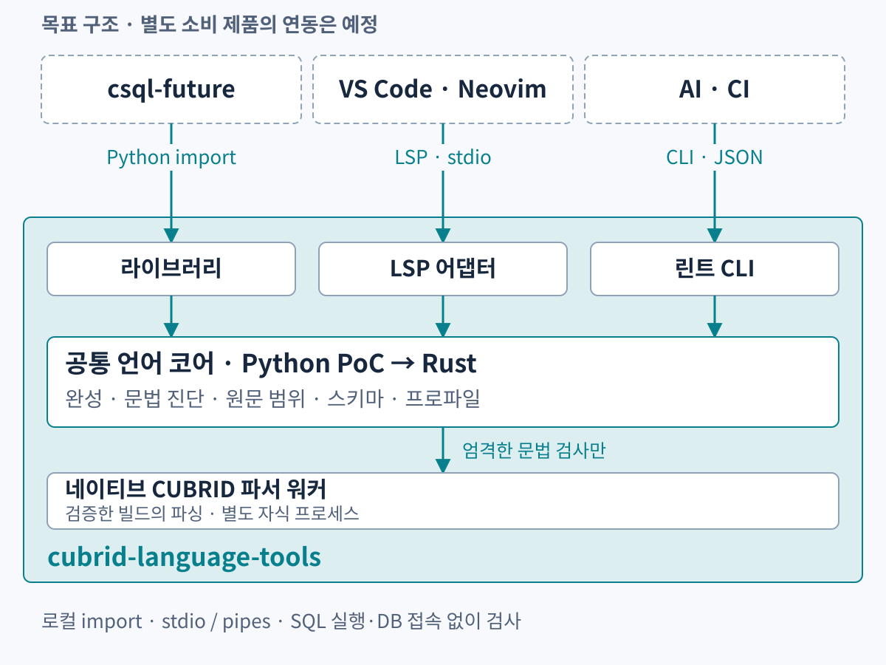

# CUBRID language tools

**한국어** | [English](README.en.md)

**CUBRID SQL 자동 완성과 문법 검사를, 여러 도구에서 같은 엔진으로.**

`cubrid-language-tools`는 CUBRID 문법·명령·스키마 정보를 관리하는 독립 공통 언어 엔진입니다.
완성 라이브러리, 오프라인 문법 검사 CLI, LSP 어댑터를 제공하고,
별도 제품인 `csql-future`·VS Code·Neovim·AI 도구가 이를 사용하도록 만듭니다.

**Python으로 PoC를 검증한 뒤, 모듈별로 Rust로 전환합니다.**
현재 구현·검증 중입니다. 아래 그림은 목표 구조이며 소비 제품 연동·편집기 패키지는 예정 기능입니다.

[아키텍처](docs/architecture.md) · [개발·제품 로드맵](docs/product-roadmap.md) ·
[CLI·검증 API](docs/lint-cli.md) · [문서 목차](docs/README.md)

## 한 엔진, 세 가지 인터페이스

| 인터페이스 | 용도 |
| --- | --- |
| **라이브러리** | 미완성 SQL의 완성 후보·대체 범위를 직접 요청 |
| **린트 CLI** | 파일·표준 입력을 검사하고 사람용·JSON 진단과 종료 상태 반환 |
| **LSP** | 여러 편집기에 같은 완성·문법 진단 제공 |

코어는 문맥·식별자·별칭·스키마·원문 위치와 진단 계약을 소유합니다.
어댑터는 전송·수명 관리, 소비 제품은 사용자 화면·메타데이터 수집을 담당합니다.
언어 지식을 편집기별로 다시 구현하지 않는 구조입니다.

## 로컬에서 동작합니다

Python 소비자는 라이브러리를 직접 import합니다.
편집기는 LSP 자식 프로세스와 stdio로 통신하고, 검증기는 네이티브 워커와 pipe의 JSON lines로 통신합니다.
공유 daemon·TCP 수신 포트·호스팅 서버는 필요하지 않습니다.

엄격한 문법 검사는 SQL 실행·DB 접속 대신 검증된 네이티브 CUBRID 파서를 사용합니다.
완성은 파싱 성공과 독립적이므로 미완성 `SELECT e.`에서도 후보를 제공해야 합니다.
파서 부재·미지원 구문·문법 오류를 구분합니다.

## Python PoC → 검증 → Rust 점진 전환

1. **Python PoC:** `cubrid_language`에서 완성·진단·스키마 계약과 CLI·LSP 흐름을 확인합니다.
2. **공통 코퍼스:** 정상·오류·미완성 SQL, 한글·이모지 위치, 스키마 후보를 비교 기준으로 기록합니다.
3. **모듈별 Rust 교체:** 후보 순서·대체 범위·진단·프로토콜 결과의 동등성을 확인하며 교체합니다.

소비 제품은 검증된 Python 인터페이스부터 사용할 수 있으며 Rust 전환과 병행합니다.
직접 Python import를 쓰는 제품의 바인딩·호환 계층은 해당 단계에서 정합니다.
네이티브 CUBRID 파서를 새 Rust SQL 문법으로 대체하는 계획은 아닙니다.

## 공통 엔진과 별도 제품의 경계

- **이 저장소:** 공통 완성·문법 진단·프로파일·스키마·소스 범위 계약, 네이티브 워커, CLI·LSP.
- **csql-future:** 히스토리·Ctrl+R·키 입력·완성 메뉴·접속·카탈로그 조회.
- **VS Code·Neovim:** 파일 연결·구문 강조·들여쓰기·확장 패키징.
- **AI·CI:** 작업 흐름·공통 진단 결과 처리 정책.

현재 csql-future는 자체 완성 구현을 사용하며 공통 엔진 전환에는 별도 동등성 검증이 필요합니다.
터미널 사용법과 내부 소개 자료는 [csql-future 저장소](https://github.com/vimkim/csql-future)에 둡니다.
공통 엔진 구조와 전환 계획은 이 저장소에서 관리합니다.

## 지원 목표와 로드맵

Python PoC의 코어·CLI는 Python 3.10 이상과 필수 Python 런타임 의존성 0개를 목표로 합니다.
LSP는 선택 의존성, 엄격한 파싱은 별도로 검증한 네이티브 런타임을 사용합니다.
첫 파서 대상은 Linux x86-64와 **CUBRID 11.5.0.2704-cc94778**입니다.
다른 빌드·버전은 별도 검증합니다.

다음 단계는 **LSP·오프라인 문법 린팅**, 별도 **VS Code·Neovim 연동과 구문 강조**입니다.
이후 **포매팅·편집기 포매팅 연동**, 의미·스타일 린트와 문법·완성 범위 확대를 검토합니다.
초기 린팅은 문법 진단입니다. 상세 범위는 [로드맵](docs/product-roadmap.md)에 있습니다.

## 참여

[이슈](https://github.com/vimkim/cubrid-language-tools/issues)에 CUBRID 버전,
공유 가능한 최소 SQL, 기대한 후보·진단과 실제 결과를 남겨 주세요.
구체적인 사례가 검증 코퍼스와 지원 범위를 정하는 근거가 됩니다.

## 라이선스

[Apache License 2.0](LICENSE).
