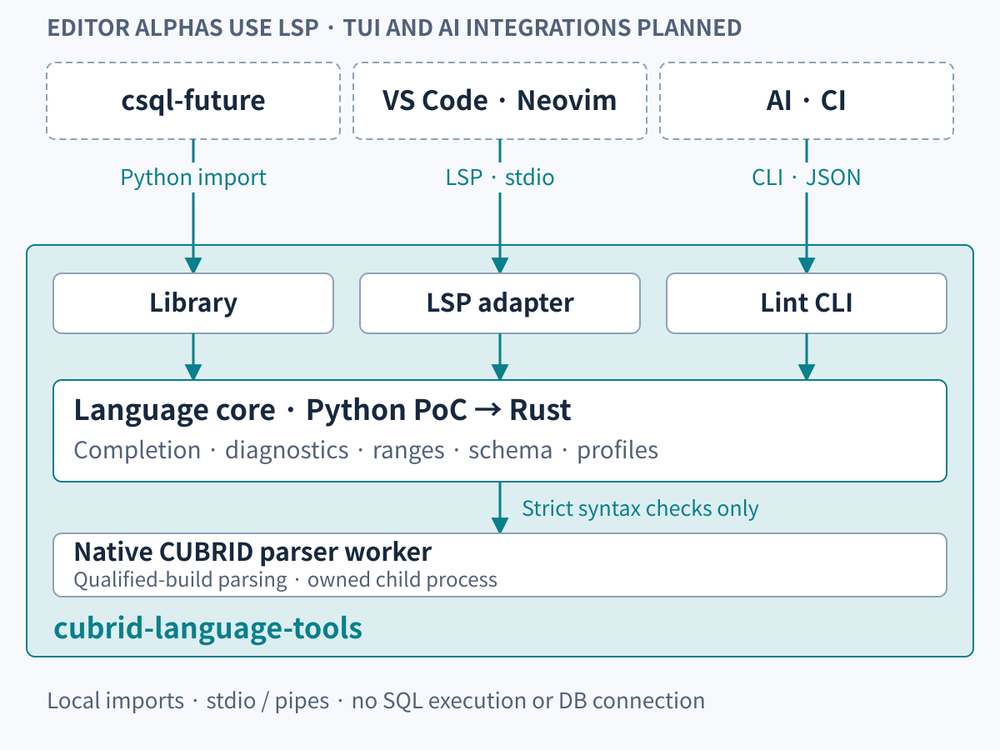

# Architecture and ownership

[한국어](architecture.md) | **English** · [Documentation](README.en.md)

The selected architecture is **an independent shared engine with library, CLI,
and LSP adapters**. Build and validate a Python PoC first, then migrate gradually
to Rust while preserving interfaces and observable behavior. The diagram shows the target architecture, not completed integrations.

## This repository owns

| Component | Responsibility |
| --- | --- |
| Completion core | Context, ordered candidates, identifier quoting, aliases, and replacement spans for unfinished SQL/CSQL |
| Syntax validator | Profile selection, coverage classification, worker lifecycle, diagnostics, and failures |
| Shared values/contracts | Source ranges, schema snapshots, diagnostic codes/severity, and version identity |
| CLI adapter | Files/stdin, human/JSON results, and exit status |
| LSP adapter | Document versions, cancellation, position conversion, and completion/diagnostic transport |
| Native parser worker | Parsing and error collection for an exact CUBRID build in a separate process |

Keep language knowledge in the core and validator. Adapters do not implement a
second SQL engine. The Python PoC package is `cubrid_language`. Core and CLI
require Python 3.10+ with zero mandatory Python runtime dependencies. LSP uses
optional dependencies. Strict parsing also needs a separately qualified native runtime.

## Separate products own

- **csql-future:** terminal editor, Ctrl+R history, keys, completion menus, connections, and catalog acquisition.
- **VS Code extension:** language identity, file associations, server settings, highlighting, indentation, and editor actions.
- **Neovim plugin:** filetype, built-in LSP setup, highlighting, indentation, and user commands.
- **AI/CI tools:** lint invocation, result handling, and workflow policies.

Each product packages and releases independently. The current csql-future
completion implementation remains until migration. History belongs to the terminal product and does not move into the shared language core.

## Call paths

| Consumer | Path |
| --- | --- |
| Python terminal | Direct library call → completion core |
| VS Code / Neovim | An editor-owned LSP child process → core/validator |
| AI / CI / shell | Lint CLI process → validator |
| Validator | Owned native worker using UTF-8 JSON lines over pipes |

LSP uses standard input/output. The design requires no shared daemon, localhost
socket, TCP listener, or hosted service. “Shared” means one maintained
implementation and contract. Completion performs no I/O. It takes text, a cursor,
a profile, and optional schema values to produce candidates.

## Completion and strict parsing stay separate

An unfinished `SELECT e.` must remain eligible for completion even when the
parser rejects it. Completion therefore does not wait for strict parsing to succeed.
A database-free parser also cannot establish that tables or columns exist.
Keep syntax success, unsupported constructs, and parser/tool failures distinct.

Canonical source ranges are half-open Unicode code-point offsets into the original
text. The LSP adapter converts them to UTF-16 positions. A Rust implementation
must not use byte indices directly as editor character positions. Korean, emoji,
and CRLF fixtures must retain the same edits and diagnostic locations.

## Native CUBRID parser boundary

The first target profile is `cubrid-11.5.0.2704-cc94778`. Qualify matching libraries,
headers, runtime assets, and settings against source
`cc947788d3b7dc402f46192d0f3299ddcc8563ba`. V3 supports bounded queries, DML, schema, engineer forms, and CSQL batches.
SHOW COLUMNS, DESCRIBE, DESC, and class-description EXPLAIN remain excluded.
See [qualified coverage](coverage.en.md) for examples, limits, and the separate 11.4 completion vocabulary provenance.

Do not replace syntax checks with SQL execution or database connections. Unknown
builds, unqualified forms, and unavailable workers cannot produce a successful
result. The Rust migration does not include replacing the native CUBRID parser with a new Rust grammar.

## From Python PoC to Rust

Use Python first to prove workflows and contracts. Then replace bounded modules
with Rust and compare results against the same corpus. Check candidate order,
replacement spans, diagnostic codes/locations/statuses, CLI exits/JSON, and LSP behavior.

LSP and CLI protocols separate consumer integration from implementation language.
Direct Python consumers will need a binding or compatibility layer when their
modules migrate. No specific FFI or binding technology is selected yet.
Do not claim Rust equivalence or performance improvements before verification.

See the [development and product roadmap](product-roadmap.en.md) for stages and release boundaries.
