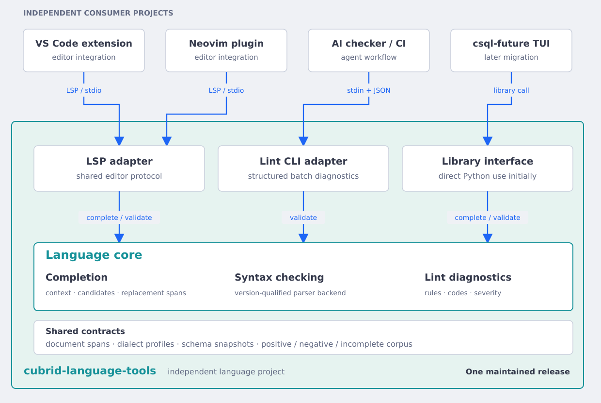

# Implementation notes and library examples

One maintained language engine for CUBRID completion, syntax checking, and lint diagnostics.
This independent project owns the Python library, native parser worker, lint CLI, and optional LSP adapter.
VS Code, Neovim, AI checkers, and csql-future are separate future consumers.



Explore the [interactive architecture](architecture.html), [specification](spec.md),
[public contracts](contracts.md), [implementation tickets](tickets/README.md), and [long-term roadmap](roadmap.md).

## Current state

Pure completion, offline schema snapshots, and the initial qualified native worker are implemented and verified.
The lint CLI and shared document validator are implemented. See the [CLI and validation API guide](lint-cli.en.md).
LSP and expanded native grammar coverage remain in progress.
Commands and interfaces in the specification become available when their tickets pass.
The first parser target is the exact CUBRID 11.5 development build `11.5.0.2704-cc94778` on Linux x86-64.
Other builds and platforms require separate qualification.
Completion remains available for unfinished SQL and when strict parsing is unavailable.
The initial linter reports syntax, unsupported coverage, and tool failures.
Semantic and style rules are future work.

The Python import package is `cubrid_language`. Core and CLI require Python 3.10+ with no mandatory Python runtime dependencies.
Strict checking also requires a separately qualified native runtime.
The language server will use optional LSP dependencies.
The configured origin is https://github.com/vimkim/cubrid-language-tools.git.
Implementation is on the local `implement/central-engine` branch pending final integration approval.

## Completion library

Install the local project in your Python environment, or use `uv sync` for development.
Then call the pure interface:

```python
from cubrid_language import complete

result = complete("sel", 3, "cubrid-11.5.0.2704-cc94778")
print(result.replacement)  # Span(start=0, end=3)
print([item.text for item in result.items])  # ["SELECT"]
```

The explicit profile is caller context for completion. Suggestions retain the inherited vocabulary and do not certify parser support.
Optional immutable `Schema` and `Relation` values supply catalog names without database access.

## Local processes

The engine runs locally. Editors spawn the language server and exchange LSP messages through stdin/stdout.
The server or lint CLI spawns its native parser worker and exchanges JSON lines through pipes.
csql-future will import the completion library directly after migration.
No localhost socket, TCP listener, network access, or database connection is required for these language operations.
“Central” means one maintained codebase and release, not a shared running daemon.
Each consumer owns the processes it starts. The hosted design in the comparison page is an alternative, not the selected design.

## Ownership

The core accepts document text, a cursor, an explicit parser profile, and optional schema metadata.
It owns language decisions and canonical source ranges.
Adapters own transport, editor lifecycle, or output formatting.
Consumers own their user interfaces and catalog acquisition.
No consumer should implement another CUBRID completion or syntax engine.

The existing csql-future terminal engine remains in place until its separate migration passes parity checks.

The [public product roadmap](product-roadmap.en.md) records the accepted Python PoC and gradual Rust migration direction.
Formatting and Rust replacements remain later work outside the current nine-ticket Python delivery graph.
