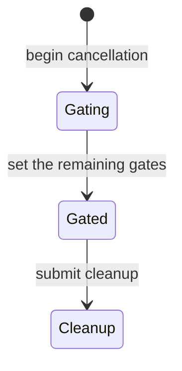

# LSP bulk cancellation: formal verification report

## Result

At dispatch `e4607ec60bd13f31b5aa4e9357f59013ee009ca5`, based on product commit `1e3be4e8a1c07a52479b16a10aa1e523ef04ca7b`, the bounded model found no counterexample to either property: all batch gates are set before the first cleanup submission, and a queued member cannot enter validation from a slot released by that cleanup after reading an unset gate. No product fix is proposed. These are model results, not a proof of arbitrary Python executions.

This target protects against unnecessary native work after configuration change or shutdown. It was chosen over the adjacent stale-diagnostic check, which also depends on document identity, version, cancellation and stopped checks in `diagnose`, and over the separate ownership/kill/reap lifecycle in `Validator` and `NativeWorker`. Those promises matter but require different models. `stop_jobs` is a particularly small concurrent boundary where the event loop and two executors can interleave despite the loop having no `await`.

## Model and interpretation

The local skill [verify-lsp-cancellation](../../../.agents/skills/verify-lsp-cancellation/SKILL.md) explains the action-to-code mapping and maintenance procedure. TLC models three batch jobs, one active job occupying one validation thread and two queued jobs. It explores ordered event setting and cleanup submission with arbitrary interleavings from queued gate reads, validation entry, natural completion, and cleanup-driven completion. It lets either queued job take the available slot, over-approximating the executor’s FIFO queue. One slot represents a selected cleanup-released slot; the production executor has four slots, and the model does not prove the multi-slot case. The `Event.is_set` read and subsequent `Validator.validate` call are separate actions. A natural finish can let a queued job start before its gate; a job that already read an unset gate can still enter validation after the event is set. Neither is claimed impossible.

The model checks cleanup submission, a stronger ordering requirement than waiting for cleanup to free a slot. It treats close-driven release as one observable completion step, permits it as soon as a close is submitted, and omits cancellation of queued asyncio futures, which may prevent additional starts. This over-approximates those effects but does not model every internal worker operation or ordering of arbitrary batches. It assumes a stable ordered batch and event-loop serialization of its two loops, and does not cover liveness, multiple slots, other job populations, stale publication, native startup, OS process semantics, or unbounded batch sizes. A process can start after a gate for a job already past its read. `Validator.close` guards its owned-worker state with `_ownership`; `NativeWorker.close` and `_start` coordinate closed/process state separately. Neither makes the gate and validation call atomic.

TLA+/TLC was selected because this is a finite event-ordering question. Release `v1.7.4` of `tla2tools.jar` has SHA-256 `936a262061c914694dfd669a543be24573c45d5aa0ff20a8b96b23d01e050e88`; its TLC identifies itself as 2.19, revision `5a47802`. The checker used one worker, Java Temurin 8.0.462, Python 3.14.0, uv 0.9.11, and the project's locked optional LSP dependencies. It generated 271 states, found 143 distinct states, exhausted the queue, and reached depth 14. TLC's fingerprint collision estimate was 9.9e-16. The separate `/statechart` interpretation counted 143 states and 257 steps and found both rules and no-deadlock satisfied; it used Temurin 21 and the same pinned jar. Its condensed chart hides 220 transitions that stay within a displayed state, including validation and natural completion:



## Mutation and replay

A scratch copy of `src/` removed the first gate loop in `Adapter.stop_jobs`, leaving the loop calling `stop_job` for each job. The matching TLA+ mutation sets `Broken = TRUE`, interleaving each gate with its cleanup submission. `/statechart` found both shortest counterexamples:

1. The first active job is gated, then its cleanup is submitted while the other jobs remain ungated: `AllGatedBeforeCleanup` fails after two steps.
2. Cleanup releases the active slot; a queued member reads its unset gate and enters validation: `NoCleanupReleasedUngatedValidation` fails after five steps.

The Python replay executes the real `Adapter.stop_jobs`, `Adapter.stop_job`, and `ValidationJob.run`, with a single real validation executor and the event loop's independent cleanup executor. Validator doubles hold the active slot until close and record validation entry. A wrapper pauses the caller after the first actual `stop_job` returns, to force a reachable scheduler interleaving; it does not set any gates or dispatch validation. Against the scratch source, the skill's command exited 1 with `cleanup submitted before all gates: True; queued validation entered after cleanup freed the slot before its gate: True`. Thus both model failures have an observed real-code replay; the replay does not claim an actual native subprocess started. The original source was never modified, and the restored baseline command passed.

## Commands and evidence

Run from the repository root:

```sh
python3 .agents/skills/verify-lsp-cancellation/run.py --mutation-test
python3 .agents/skills/verify-lsp-cancellation/run.py
XDG_CACHE_HOME=/tmp/cubrid-lsp-verify-cold-cache python3 .agents/skills/verify-lsp-cancellation/run.py
uv run --locked --extra lsp python -m unittest discover -s tests/lsp -v
uv run --no-project --with pyyaml python /home/vimkim/.codex/skills/.system/skill-creator/scripts/quick_validate.py .agents/skills/verify-lsp-cancellation
```

The cold-cache run downloaded the pinned jar, verified its digest, and passed. All 28 LSP tests and the frontmatter validator passed. The `--mutation-test` command creates the scratch copy, requires the real replay to observe both violations, and checks each model invariant independently with `Broken = TRUE`; the baseline command then passed. Interpret both baseline and mutation with `/statechart`. Its counterexample artifacts were produced in `/tmp/lsp-cancel-statechart/broken2`, and the baseline chart in `/tmp/lsp-cancel-statechart/baseline-final`; temporary artifacts are not required for a rerun.

The initial checkout was clean. `.venv`, Python bytecode and packaging metadata are ignored disposable outputs. The dispatch commit is a descendant of the product baseline, and no covered product source changed between them. The implementation commit changes only the skill and this report; the coordinator also records the ticket, dispatch, and follow-up state. No shared recipe, packaging, product code, push, or integration was changed.

## Coordinator review

Independently reviewed implementation `e6e5d7dd2e8bca17d3db28fc9183bb084195f496`: inspected each model action against the covered Python functions, the executor boundaries, the scratch-copy mutation, tool pinning, and the cold-agent instructions. Reviewed the baseline and both shortest counterexamples using the `/statechart` reports. The scope distinguishes checked methods from ownership/context code and explicitly limits the one-slot model relative to production's four slots.

From a separate review environment, the normal command passed with 271 generated states, 143 distinct states, no queued states and depth 14. The `--mutation-test` command independently caught both early cleanup and actual queued validation in the scratch Python source, and both model invariants failed as expected. The normal command passed again after the negative test. The unchanged product baseline also independently passed all 28 framed LSP tests. Logs are in `/tmp/cubrid-language-formal-579-review-iuNJOm/` (`baseline-lsp.log`, `verification.log`, `mutation.log`, and `restored-baseline.log`).

`git diff --check` passed, and comparison to `1e3be4e8a1c07a52479b16a10aa1e523ef04ca7b` confirmed no changes to `src/`, `pyproject.toml`, `uv.lock`, `justfile`, or `MANIFEST.in`. No actionable review findings remain within this ticket's stated scope. At review completion, main integration and its configured push required a fresh approval for this follow-up; prior central-build approval did not cover it.

## Approved integration

The user approved the follow-up's main integration and configured main push. Preflight confirmed clean destination `main` at `1e3be4e8a1c07a52479b16a10aa1e523ef04ca7b`, clean task branch `verify/lsp-cancellation` at the reviewed `e53e9199face41b912b38374c262e743358d4141`, and matching fetched `origin/main`. Rebase onto local `main` left the approved commits unchanged. After rebase, the negative test caught both real-code violations and both model invariants, the restored baseline passed, and all 28 LSP tests passed.

Fast-forward integration preserved the exact approved tip and tree. Running the normal verifier from the destination checkout passed the real-code replay and both model invariants with 271 generated states, 143 distinct states, no queued states, and depth 14. This bookkeeping update changes only the report and follow-up state.

Evidence is preserved in `/home/vimkim/temp/cubrid-language-formal-579-integration-TAyBfj`: premerge mutation, model and LSP logs; the main model log; independent review logs; the baseline and counterexample statechart artifacts; and the approved skill/report snapshots. The final remote SHA and scoped task worktree/branch cleanup are recorded in work item 579. Ignored virtual environments, bytecode and packaging metadata are disposable outputs; no valuable native build artifacts are present in this task worktree.
